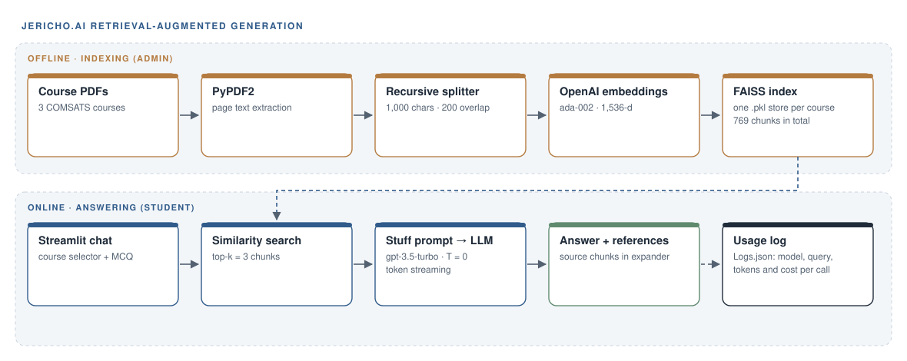
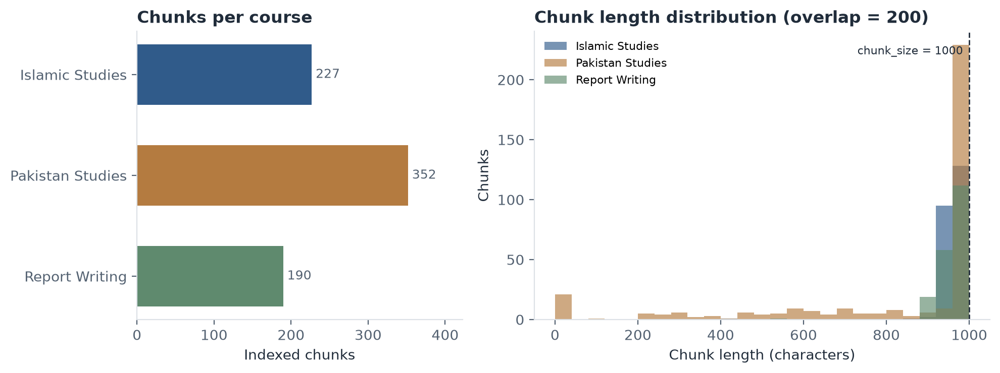
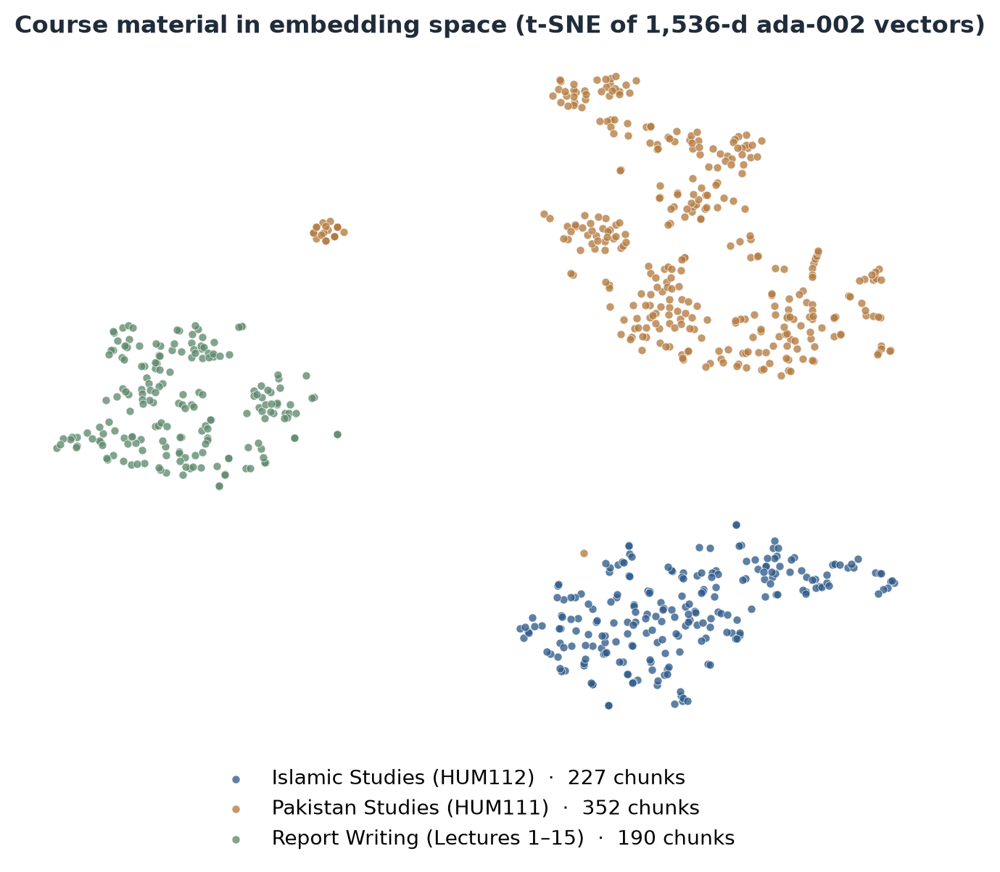

<div align="center">


# Jericho.ai

**Course-grounded multiple-choice answering with retrieval-augmented generation (RAG).**
Jericho answers questions from the actual lecture handouts of a course and shows the passages it relied on.

[](https://danishzulfiqar-projects.vercel.app/jericho-ai)


</div>

> 📘 **Full write-up with figures:** [danishzulfiqar-projects.vercel.app/jericho-ai](https://danishzulfiqar-projects.vercel.app/jericho-ai)

## The problem

COMSATS University runs several general-education courses (Islamic Studies, Pakistan Studies, Report Writing) as **hybrid courses** assessed largely through multiple-choice quizzes. A general-purpose chatbot answers such questions from its own background knowledge. That knowledge is often right, but it is not necessarily what *the course* teaches, and it gives the student no way to check.

Jericho restricts the language model to the **course's own handouts**. For every question it retrieves the most relevant passages, asks the model to answer only from that context, and displays the passages next to the answer so the student can verify the reasoning.

## Architecture

<p align="center"></p>

**Offline indexing (admin only).** Lecture PDFs are parsed with PyPDF2 and split by LangChain's `RecursiveCharacterTextSplitter` into 1,000-character chunks with 200 characters of overlap, so that no definition or list is cut in half. Each chunk is embedded with OpenAI `text-embedding-ada-002` (1,536 dimensions) and stored in a **separate FAISS index per course**, serialised to `VectorStore/<course>.pkl`. Uploading new material is switched off for students (`uploadable = False`), so only an administrator can change the knowledge base.

**Online answering.** The student picks a course and types a question in the Streamlit chat. Jericho then:

1. runs a similarity search over that course's index and keeps the **top 3 chunks**;
2. passes them as context to `gpt-3.5-turbo` (temperature 0, for deterministic answers) through a LangChain *stuff* QA chain;
3. **streams** the answer token by token and lists the retrieved chunks under a *References* expander;
4. appends the model, query, token usage and cost of every call to `Logs.json` for cost monitoring.

Keeping one index per course stops material from one subject leaking into answers for another, and keeps each search small and fast.

## The knowledge base

The repository ships with ready-built indexes for three courses: **769 chunks** in total. The figures below were generated directly from the committed FAISS stores by [`scripts/generate_figures.py`](scripts/generate_figures.py). No API calls are needed.

<p align="center"></p>

<p align="center"></p>

The t-SNE projection shows the three courses forming **clearly separated regions** of the embedding space. A 5-nearest-neighbour classifier recovers the course of a chunk from its embedding with **99.6 %** cross-validated accuracy. Within each course, tighter sub-clusters group passages on related topics. This is the local structure that top-3 retrieval relies on.

| Course | Chunks | Mean chunk length |
|---|---:|---:|
| Islamic Studies (HUM112) | 227 | 960 chars |
| Pakistan Studies (HUM111) | 352 | 827 chars |
| Report Writing (Lectures 1–15) | 190 | 960 chars |

## Quick start

### Docker (recommended)

```bash
git clone https://github.com/danishzulfiqar/Jericho.ai.git
cd Jericho.ai
cp .env.example .env          # then set OPENAI_API_KEY=sk-...
docker compose up --build
```

Open **http://localhost:8501**.

### Local Python

```bash
python -m venv .venv && source .venv/bin/activate
pip install -r requirements.txt
echo "OPENAI_API_KEY=sk-..." > .env
streamlit run app.py
```

### Adding a course

Set `uploadable = True` in `app.py`, upload the course PDF in the UI, and Jericho builds and saves `VectorStore/<file name>.pkl` automatically. Set the flag back to `False` before deploying.

## Deployment

The app runs as a single Docker container (`python:3.8-slim`, port 8501) on **Amazon EC2**, with a custom domain routed through **Amazon Route 53**. The `deployment` branch is the production build, which carries an extended Report Writing index (lectures 1–27). Because the vector stores are committed, the container starts serving immediately without re-embedding anything.

## Configuration

| Setting | Location | Default |
|---|---|---|
| Chunk size / overlap | `RecursiveCharacterTextSplitter` | 1,000 / 200 characters |
| Retrieved chunks | `similarity_search(k=…)` | 3 |
| Chat model / temperature | `model_name`, `temperature` | `gpt-3.5-turbo`, 0 |
| Admin-only upload | `uploadable` | `False` |
| Hide Streamlit menu / deploy button | `menu_hide`, `deploy_btn` | `False`, `False` |

## Repository layout

```
├── app.py                      # Streamlit app: indexing, retrieval, streaming answers, logging
├── VectorStore/                # one FAISS index per course (.pkl)
├── scripts/generate_figures.py # README figures from the vector stores
├── Assets/                     # logo, architecture diagram and figures
├── Dockerfile · docker-compose.yml
└── .env.example
```

## Author

**Danish Zulfiqar**. [danishzulfiqar.com](https://danishzulfiqar.com) · [GitHub](https://github.com/danishzulfiqar)
